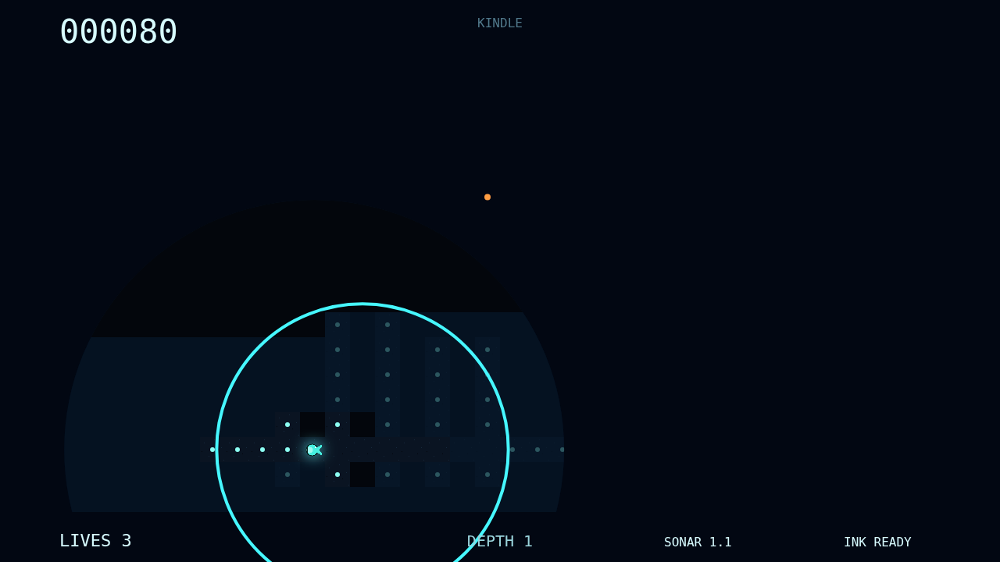
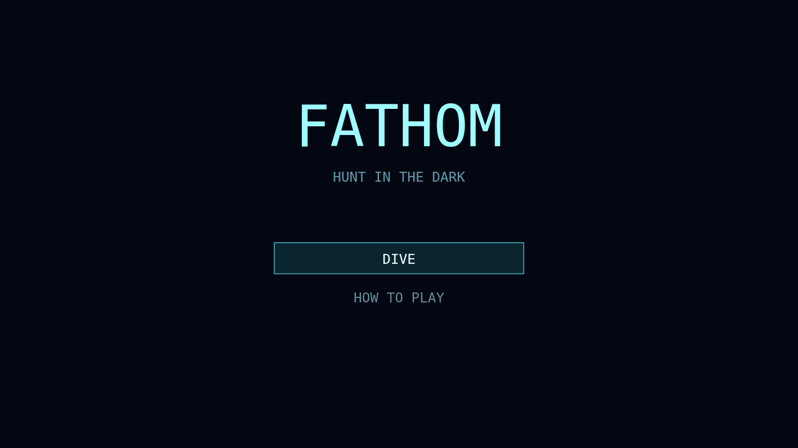

# Fathom

Slip into a trench where the maze exists only as far as your glow can reach. Graze bright plankton to swell both your light and the circular window into remembered ground, then watch the abyss close over distant passages again.

Sonar rolls through corridors and briefly sketches safe routes, but sound has a cost: the eyeless Gloamfin hears every pulse. Ink can break the sight of hunters that track your light, while the Flarefish periodically burns whole regions into view.

Three predators turn every amber glimmer into a decision. A harmless drifter and the disguised Lanternjaw look identical at a distance; the only sure answer may be close enough to bite. Clear the plankton, descend deeper, and survive as your sonar reach shrinks and the den releases more hunters.

